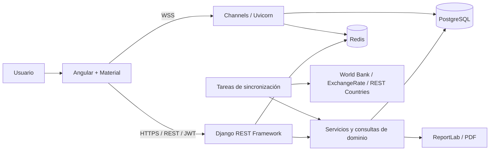

# Arquitectura y decisiones técnicas

DataPulse usa un monolito modular Django, una SPA Angular y PostgreSQL. Cada
módulo mantiene sus reglas y modelos; las consultas HTTP externas se realizan
durante sincronizaciones y las pantallas consultan los datos persistidos.

## Componentes

| Módulo | Responsabilidad |
| --- | --- |
| accounts | Acceso por email, JWT, perfil y roles. |
| countries | Países y catálogo de monedas. |
| economics | Indicadores, cotizaciones e integraciones persistidas. |
| risk | IRPC, desglose y evidencia histórica. |
| alerts | Reglas, eventos idempotentes y lecturas independientes por usuario. |
| portfolios | Posiciones, límites, privacidad y edición concurrente. |
| dashboard | KPI, mapa y tendencias de cinco años. |
| reporting | PDF sobre una instantánea autorizada. |
| audit | Registro de actividad con metadatos tipados. |
| realtime | Avisos autenticados de alertas y cambios del dashboard. |
| integrations | Clientes HTTP con timeouts y reintentos; no acceden al ORM. |
| common | Errores, paginación, permisos compartidos, caché y límites. |

Una petición pasa por autenticación y permisos, vista/serializador, servicio o
selector, ORM y PostgreSQL. Las escrituras validan las reglas de negocio dentro
de su transacción; las notificaciones se publican después del commit.

`backend.workflows` coordina sincronización → recálculo → alertas → auditoría.
Cada etapa conserva datos válidos y comunica errores o trabajo pendiente.
El detalle del almacenamiento está en [MODELO_DATOS](backend/MODELO_DATOS.md).

## Elecciones

| Elección | Motivo y alternativa considerada |
| --- | --- |
| Monolito modular | Mantiene transacciones y un despliegue sencillo. Los microservicios añadirían coordinación sin una necesidad demostrada. |
| PostgreSQL y ORM Django | Constraints, Decimal y bloqueos de fila para reglas de capital y concurrencia. SQLite simplifica desarrollo, pero no verifica esos bloqueos. |
| DRF y SimpleJWT | Serialización, permisos y autenticación estándar para la SPA. Las sesiones de navegador requerirían otro contrato de cookies/CSRF. |
| Comandos Django | Ejecutables bajo demanda o mediante cron; no necesitan una cola Celery permanente para estas tareas. |
| Angular standalone y carga diferida | Separación por funcionalidades y carga por ruta, sin NgModules adicionales. |
| Signals y BehaviorSubject | Estado local derivado con signals; alertas publicadas como Observable. NgRx introduciría más estructura de la necesaria para este alcance. |
| Material y Chart.js | Componentes accesibles y gráficos; el mapa SVG usa geografía Natural Earth sin un servicio externo. |
| ReportLab | Genera PDF en memoria sin navegador ni servicio adicional. |
| ASGI, Channels y Redis | HTTP y conexiones en vivo con coordinación entre workers. Redis transporta avisos; PostgreSQL conserva los datos. |
| Docker y Railway | Imágenes separadas para backend/frontend y servicios persistentes de PostgreSQL y Redis. |

## Consistencia y seguridad

Las modificaciones de portafolios y posiciones bloquean el portafolio y exigen
su `version`. El primer cambio incrementa la versión; otro con la anterior
recibe 409. Angular conserva el borrador y solicita revisar los datos recargados.
VIEWER no escribe; ANALISTA edita propios y públicos; solo propietario con
escritura o ADMIN elimina y cambia visibilidad.

Los importes y tasas se almacenan como Decimal. El IRPC conserva sus entradas,
fuentes, penalizaciones y faltantes en una instantánea, para poder reproducirlo.
Las lecturas de alertas globales se guardan por usuario; no cambian las de otros.

La API entrega errores consistentes y limita solicitudes. CORS y orígenes de
WebSocket son explícitos. Los logs no guardan cuerpos ni credenciales.
Los secretos se suministran mediante variables de entorno.

Redis transporta eventos de refresco sin reproducción garantizada. Al reconectar,
Angular recupera el estado por REST; si falla la conexión en vivo, usa polling.
La API REST conserva transacciones síncronas dentro de ASGI; el pool PostgreSQL
es independiente por worker. No se usa un límite TCP global para bloquear
solicitudes HTTP mientras hay WebSockets abiertos.

Configuración operativa: [Railway](deployment/RAILWAY.md).
