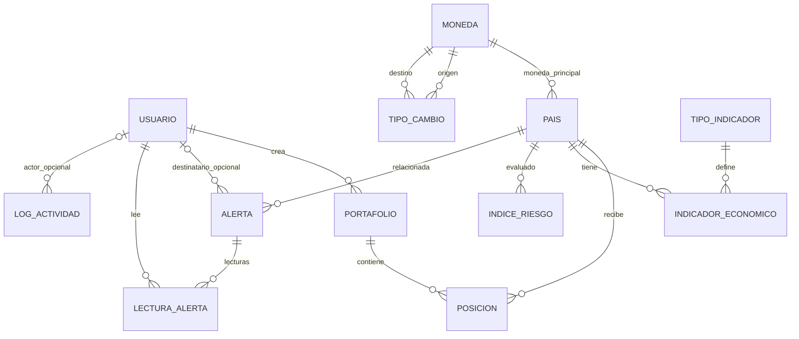

# Modelo de datos normalizado — DataPulse Latam

Diseño del backend como monolito modular: una aplicación Django y una base
PostgreSQL compartida. Cada módulo es responsable de sus tablas.

Estado: **diseño previo a la implementación**. Actualmente solo está implementado
`accounts.User`. Este documento no acredita la creación de las demás tablas ni
la aplicación de migraciones. Los nombres de tablas son lógicos; Django podrá
prefijarlos con el nombre de la app.

## Criterios de normalización

- Primera forma normal: columnas atómicas y relaciones mediante claves; ninguna
  lista de países, posiciones o lectores dentro de una columna.
- Segunda forma normal: cada observación pertenece a un país, un tipo y un año;
  los atributos del tipo de indicador pertenecen a su catálogo.
- Tercera forma normal: el nombre de moneda depende de su código, no del país;
  la unidad y el código World Bank dependen del tipo de indicador, no de cada
  observación. Se extraen esas dependencias a tablas propias.
- Las opciones cerradas sin atributos propios (rol, región, tipo de activo,
  severidad, acción) se mantienen como códigos con `TextChoices` y restricciones
  de base de datos. No necesitan una tabla solo para guardar el mismo código.
- Los JSON de cálculo y auditoría contienen evidencia histórica de estructura
  variable; no sustituyen las relaciones, ni almacenan listas de entidades.

## Tablas, claves y atributos

`PK` identifica la fila, `FK` referencia otra tabla, `UQ` indica unicidad.
Todas las fechas con hora son conscientes de zona horaria; los importes y tasas
usan `Decimal`, nunca coma flotante para persistencia monetaria.

| Módulo | Tabla | Claves | Otros atributos |
| --- | --- | --- | --- |
| accounts | Usuario | PK id; UQ email normalizado | password (hash), nombre_completo, rol, activo, fecha_creacion, last_login y permisos heredados de Django |
| countries | Moneda | PK codigo (3 caracteres) | nombre |
| countries | Pais | PK codigo_iso (2 caracteres); FK moneda → Moneda | nombre, region, latitud, longitud, poblacion, bandera_url, activo |
| economics | TipoIndicador | PK codigo | nombre, unidad, codigo_world_bank (UQ) |
| economics | IndicadorEconomico | PK id; FK pais → Pais; FK tipo → TipoIndicador; UQ (pais, tipo, anio) | valor, anio, fuente, fecha_actualizacion |
| economics | TipoCambio | PK id; FK moneda_origen → Moneda; FK moneda_destino → Moneda; UQ (moneda_origen, moneda_destino, fecha) | tasa, fecha, fuente |
| portfolios | Portafolio | PK id; FK usuario → Usuario; UQ (usuario, nombre) | nombre, descripcion, fecha_creacion, fecha_modificacion, activo, es_publico, version |
| portfolios | Posicion | PK id; FK portafolio → Portafolio; FK pais → Pais | tipo_activo, monto_inversion_usd, fecha_entrada, fecha_salida nullable, notas |
| risk | IndiceRiesgo | PK id; FK pais → Pais | fecha_calculo, score_economico, score_cambiario, score_estabilidad, indice_compuesto, version_formula, detalle_calculo JSON |
| alerts | Alerta | PK id; FK usuario → Usuario nullable; FK pais → Pais | tipo_alerta, severidad, titulo, mensaje, fecha_creacion |
| alerts | LecturaAlerta | PK id; FK usuario → Usuario; FK alerta → Alerta; UQ (usuario, alerta) | fecha_lectura |
| audit | LogActividad | PK id; FK usuario → Usuario nullable | accion, entidad_afectada, entidad_id, detalle JSON, ip_address nullable, fecha |

`dashboard`, `reporting`, `integrations` y `common` no requieren tablas propias
en esta fase. Obtienen datos de los módulos anteriores.

### Usuario

El email es la identidad de acceso y se normaliza antes de comprobar unicidad.
Debe conservarse un único estado activo, usando `is_active` en Django y `activo`
en la API. Tampoco se duplican `nombre_completo` y `fecha_creacion` con
`first_name`, `last_name` o `date_joined`.

El modelo elimina `username` mediante `username = None` en la subclase de
`AbstractUser`; conserva `USERNAME_FIELD = 'email'`. Este ajuste ya se implementó
con `0002_remove_username`, adaptando manager, serializer, admin y pruebas;
los formularios personalizados ya usan email. La migración se aplicó conservando
los usuarios existentes y la migración inicial. Las demás tablas siguen en diseño.

Los permisos de Django y el rol de negocio son conceptos distintos: ser
superusuario no equivale automáticamente a tener el rol ADMIN.

### Monedas y países

El país guarda únicamente una FK a Moneda. `moneda_codigo` y `moneda_nombre`
se obtienen al serializar la relación. Una misma moneda puede pertenecer a
varios países; por ello no es única en Pais. El alcance requiere una moneda
principal por país, no una relación muchos a muchos.

Las cotizaciones apuntan a monedas en ambos extremos, nunca a un campo no único
de Pais. La convención será **unidades de destino por una unidad de origen**:
COP → USD almacena USD por COP. El adaptador debe invertir una cotización
USD → COP recibida del proveedor. Los pares idénticos representan identidad y
se resuelven como tasa 1 sin guardar cotizaciones USD → USD.

### Catálogo de indicadores

| codigo | unidad | codigo_world_bank |
| --- | --- | --- |
| PIB | USD | NY.GDP.MKTP.CD |
| INFLACION | PORCENTAJE | FP.CPI.TOTL.ZG |
| DESEMPLEO | PORCENTAJE | SL.UEM.TOTL.ZS |
| BALANZA_COMERCIAL | PORCENTAJE | NE.RSB.GNFS.ZS |
| DEUDA_PIB | PORCENTAJE | GC.DOD.TOTL.GD.ZS |
| PIB_PERCAPITA | USD | NY.GDP.PCAP.CD |

PIB se almacena en USD corrientes, como lo entrega el proveedor. Mostrar miles
de millones es una transformación de presentación, no una segunda unidad para
el mismo tipo. La API conserva el campo `unidad` leyéndolo del catálogo.
Para aceptar otra unidad de entrada, el servicio convierte el valor antes de
guardarlo. `fuente` pertenece a cada observación y admite WORLD_BANK o MANUAL.

### Lecturas de alertas

`Alerta.usuario = null` significa alerta global; en otro caso es privada para
ese destinatario. No se guarda un booleano `leida` en Alerta: una lectura global
no debe afectar a los demás usuarios. La existencia de LecturaAlerta determina
`leida` para el usuario autenticado y permite conocer cuándo la leyó.
Solo se puede leer una alerta global o dirigida al propio usuario.

### Datos calculados y evidencia histórica

| Dato | Decisión |
| --- | --- |
| Variación cambiaria | Calcular con la cotización del día calendario anterior del mismo par; si falta, devolver null y señalar el dato faltante. No usar silenciosamente el último dato de otra fecha. |
| Nivel de riesgo y color | Derivar del indice_compuesto con umbrales 75, 50 y 25. No almacenarlos en columnas independientes. |
| Índice compuesto | Guardarlo como resultado histórico, junto a los tres scores y la versión de fórmula; calcularlo en una única operación, con pesos 0.40 / 0.30 / 0.30 y redondeo decimal definido. |
| Totales, distribuciones y riesgo ponderado del portafolio | Consultarlos desde posiciones activas e índices de riesgo; no guardarlos en Portafolio. |
| Estado activo de una posición | Obtenerlo de fecha_salida; no añadir otro booleano. |
| Datos de entrada del IRPC | Conservar una instantánea en detalle_calculo: valores, fechas, fuentes, penalizaciones y faltantes. No depender de que los indicadores actuales permanezcan iguales. |

El índice compuesto y el desglose son una redundancia deliberada de un resultado
histórico auditable, no tablas operativas duplicadas. La versión de fórmula
permite explicar qué reglas produjeron cada resultado. Un país puede tener
varios cálculos el mismo día; no se impone unicidad por país y fecha diaria.

## Integridad y validaciones

En base de datos:

- Las PK, FK y UQ de la tabla anterior.
- Email obligatorio y único normalizado; códigos y enums con valores admitidos.
- Latitud entre −90 y 90, longitud entre −180 y 180, población no negativa.
- Tasa mayor que cero; moneda_origen diferente de moneda_destino.
- Año positivo; valores de indicadores admiten negativos (por ejemplo balanza).
- Monto de posición entre 1.000 y 10.000.000 USD.
- Fecha de salida nula o estrictamente posterior a fecha de entrada.
- Los tres scores y el compuesto entre 0 y 100; version de Portafolio positiva.
- Longitudes: nombre de portafolio 3–100, descripción hasta 500, notas hasta 200.
  La longitud máxima de `CharField` la protege PostgreSQL; los mínimos y enums
  requieren checks explícitos además de validadores Django.

En serializers y servicios transaccionales:

- VIEWER no crea ni modifica portafolios ni posiciones; ADMIN y ANALISTA también
  deben satisfacer las reglas de propiedad. Público habilita lectura.
- Fecha de entrada no futura; datos y mensajes de validación en español.
- No agregar MONEDA cuando la moneda principal del país es USD.
- Capital activo total del portafolio máximo 50.000.000 USD.
- Máximo dos posiciones activas por portafolio, país y tipo de activo.
- Bloquear la fila de Portafolio antes de validar agregados y guardar cambios;
  verificar e incrementar version dentro de la misma transacción. Responder 409
  ante versiones desactualizadas.
- Lecturas de alertas privadas limitadas a su destinatario.

Los límites agregados y reglas entre tablas no se resuelven con un CHECK de una
sola fila. Deben comprobarse al agregar, editar y cerrar posiciones. No se
proponen permisos de edición compartida hasta definir explícitamente su alcance.

### Índices y eliminación

- IndicadorEconomico: su UQ cubre búsquedas por país/tipo/año.
- TipoCambio: su UQ cubre el par y el histórico por fecha.
- IndiceRiesgo: índice (pais, fecha_calculo) para obtener el último y el histórico.
- Alerta: índices (usuario, fecha_creacion) y (tipo_alerta, severidad).
- Posicion: índice parcial (portafolio, pais, tipo_activo) donde fecha_salida
  sea nula para validar posiciones abiertas y calcular exposición.
- LogActividad: índices (usuario, fecha) y (entidad_afectada, entidad_id, fecha).
- LecturaAlerta y Portafolio aprovechan sus índices únicos; evitar duplicarlos.

Portafolio se elimina lógicamente y Posicion se cierra, conservando el histórico.
Países y monedas referenciados se protegen de eliminación física. Usuarios con
portafolios o alertas privadas se protegen de eliminación y se desactivan: no
usar SET_NULL en el destinatario de Alerta, porque convertiría una alerta privada
en global. Lecturas pueden usar CASCADE si se elimina su alerta o su usuario.
En LogActividad, SET_NULL conserva la evidencia si se elimina un usuario sin
otras referencias protegidas. `entidad_afectada` y `entidad_id` identifican el
objeto histórico aun si ya no existe; no se presentan como una FK garantizada.

## Diagrama de relaciones

## Compatibilidad con el enunciado

Los nombres y campos de la API pueden conservarse aunque cambie el almacenamiento:
`moneda_codigo` y `moneda_nombre` proceden de Moneda; `tipo` y `unidad` del catálogo;
`variacion_porcentual`, `nivel_riesgo` y `leida` son campos calculados. El modelo
objetivo agrega Moneda, TipoIndicador y LecturaAlerta, elimina duplicidades y
mantiene los históricos requeridos.

El algoritmo y el ejemplo del enunciado discrepan en inflación: 9,2 % recibe −10
según el algoritmo, frente a −25 en el ejemplo. Usar provisionalmente el algoritmo
y registrar la regla en version_formula; la normalización no cambia sus umbrales.

## Orden de implementación posterior

1. **Completado:** migración incremental de Usuario para eliminar username y adaptar sus consumidores.
2. countries: Moneda y Pais.
3. economics: TipoIndicador, IndicadorEconomico y TipoCambio.
4. portfolios, risk, alerts y audit con sus dependencias anteriores.
5. Catálogos y datos de demostración; servicios, API y pruebas de integridad.

No editar migraciones ya aplicadas ni reiniciar la base. Verificar las futuras
migraciones con los datos existentes y con una base de pruebas desde cero.
