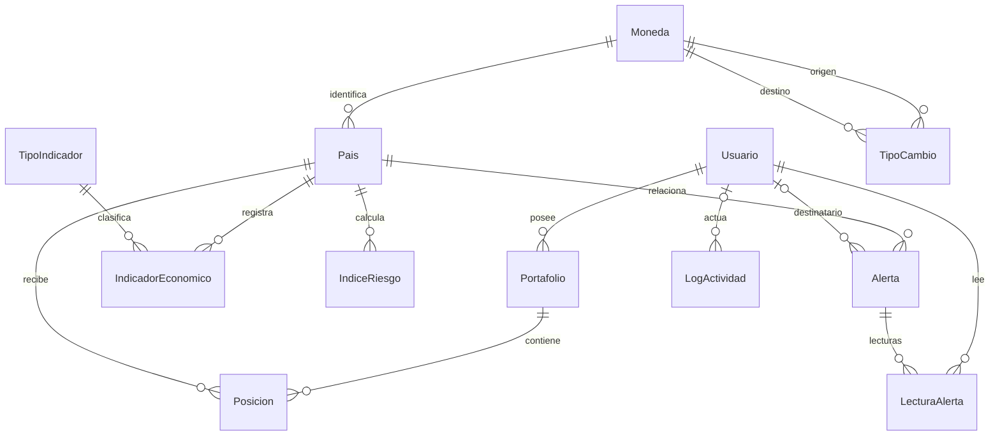

# DataPulse Latam - backend

API Django 5.2 + Django REST Framework, JWT y PostgreSQL para monitoreo económico,
riesgo país, alertas y portafolios. Monolito modular; los proveedores externos se
consultan durante sincronizaciones y las lecturas usan datos persistidos.

## Estado actual

Implementados: accounts, countries, economics, risk, alerts, portfolios, audit,
dashboard, reporting y realtime. No se agregaron tablas ni migraciones para dashboard/PDF:
consumen el modelo existente. Errores uniformes en español, throttling, logs JSON
de requests y CORS configurable están conectados a la API completa.

Se entrega arranque ASGI/Uvicorn, WhiteNoise para estáticos, Dockerfile y plantillas
de tareas programadas. Publicación/URL pública pendiente de proveedor y cuenta.
REST Countries tiene una [prueba real satisfactoria de los diez países](../docs/backend-audit-20261010/REST_COUNTRIES.md)
con proveedor autenticado, persistencia en PostgreSQL temporal y lecturas HTTP
con JWT; la base principal se conservó. Una nueva instalación necesita su propia
`REST_COUNTRIES_API_KEY` para sincronizar. El frontend conserva su base Angular;
la implementación e integración de sus formularios y su publicación siguen pendientes.
Guía conjunta de entrega y Postman en el [README raíz](../README.md).

## Instalación local reproducible

Requiere Python 3.12+ y PostgreSQL accesible. Crear una base vacía y un rol con
permisos de conexión/migración. Para verificar pruebas, ese rol debe poder crear
bases temporales (`CREATEDB`). Trabajar desde la carpeta backend:

```bash
python -m venv .venv
. .venv/bin/activate
pip install -r requirements-dev.txt
cp .env.example .env
```

Completar POSTGRES_DB/USER/PASSWORD/HOST/PORT y DJANGO_SECRET_KEY en `.env`.
Las variables exportadas por el proceso tienen prioridad sobre el archivo; no
se interpolan caracteres `$` dentro de valores. `.env` está ignorado por Git.

```bash
python manage.py check
python manage.py migrate
python manage.py seed_data
python -m uvicorn backend.asgi:application --reload --lifespan off --no-proxy-headers
```

API local: `http://127.0.0.1:8000/api/`. Documentación: `/api/docs/` y
[contrato completo](API.md). Health: `/health/`. Admin: `/admin/`; crear un
superusuario propio con `python manage.py createsuperuser` si se necesita acceder.
El rol ADMIN de negocio no concede automáticamente is_staff/is_superuser.

## Datos de demostración

`seed_data` crea las tres identidades exigidas por la prueba:

| Email | Rol | Contraseña de demostración |
| --- | --- | --- |
| admin@datapulse.com | ADMIN | DataPulse2026! |
| analista@datapulse.com | ANALISTA | DataPulse2026! |
| viewer@datapulse.com | VIEWER | DataPulse2026! |

También carga 10 países, 300 observaciones (6 indicadores por país durante cinco
años), 279 cotizaciones (31 por cada una de nueve monedas distintas de USD), dos
portafolios con cuatro posiciones para ANALISTA e índices calculados para los diez
países. Ecuador/USD se resuelve como identidad sin persistir USD/USD.

El seed es repetible, conserva usuarios/registros existentes y crea cálculos
solo si añadió datos o faltan países con índice. Si una identidad DEMO ya existe
con otro rol, estado o contraseña, aborta de forma explícita sin resetearla.
La contraseña fija del enunciado es una excepción acotada a estas cuentas; la
política de registro y perfil sigue activa. Poblaciones e históricos son
ilustrativos, los indicadores/cotizaciones tienen `es_simulado=true`.

Los comandos individuales permiten cargar por etapas:

```bash
python manage.py seed_countries
python manage.py seed_economics
python manage.py seed_portafolios --usuario analista@datapulse.com
python manage.py calcular_riesgos
```

31 cotizaciones permiten 30 variaciones diarias. El seed anterior de 30 se amplía
sin cambiar sus valores; datos manuales reales nunca se sustituyen por simulación.
Las alertas se generan desde eventos reales del sistema: un dataset estable puede
tener un panel vacío. No se insertan alertas ficticias como si fueran reales.

## Arquitectura y modelo

```text
HTTP/JWT -> views/serializers/permisos -> servicios/selectors -> ORM -> PostgreSQL
                       |                     |
                dashboard/reporting     backend.workflows
                                       /       |        \
                                economics     risk     alerts -> audit
                                    |
                               integrations -> proveedores HTTP
```

| Módulo | Responsabilidad |
| --- | --- |
| accounts | Identidad por email, JWT, perfil y roles. |
| countries | Países y catálogo de monedas. |
| economics | Indicadores, cotizaciones, historial y sincronización. |
| risk | IRPC versionado y evidencia histórica reproducible. |
| alerts | Eventos idempotentes y lecturas independientes por usuario. |
| portfolios | Posiciones, validaciones, colaboración y versiones. |
| audit | Actividad explícita con metadatos tipados sin secretos. |
| dashboard | KPI, mapa y series de cinco años. |
| reporting | PDF a partir de una instantánea autorizada. |
| common | Infraestructura compartida; no importa reglas de negocio. |
| integrations | HTTP, timeouts y reintentos; no accede al ORM. |



Diccionario y constraints en [MODELO_DATOS](MODELO_DATOS.md). Separar Moneda,
TipoIndicador y LecturaAlerta elimina nombres/unidades duplicados y evita que la
lectura de una alerta global afecte a otras personas. `leida`, nivel/color y
variación cambiaria se derivan para la API; montos/cotizaciones usan Decimal.

Diagrama generado desde los modelos: [SVG normalizado](docs/modelo-normalizado.svg).

Se elige PostgreSQL por constraints, bloqueos de fila y concurrencia. Se evitan
repositorios que dupliquen el ORM, microservicios sin necesidad comprobada y
Celery/Redis hasta requerir una cola. Los comandos Django están permitidos por
la prueba. ReportLab genera PDF sin navegador ni servicio externo; CORS y estáticos
se resuelven con django-cors-headers y WhiteNoise; Uvicorn sirve ASGI.

## Permisos, concurrencia y riesgo

JWT activo requerido para los datos. VIEWER consulta propios/públicos y exporta,
pero no modifica. ANALISTA crea y edita propios/públicos; privados ajenos no son
visibles. ADMIN accede a todos los portafolios. Solo propietario con escritura o
ADMIN elimina/cambia visibilidad. Alertas privadas son solo del destinatario.

Cada cambio de portafolio/posición requiere `version`, bloquea el portafolio y
valida permisos y límites dentro de una transacción; éxito incrementa la versión,
conflicto devuelve 409. El cliente debe recargar/revisar, sin sobrescritura automática.

IRPC usa pesos 0.40/0.30/0.30 y niveles BAJO >=75, MODERADO >=50, ALTO >=25,
CRITICO <25. Datos ausentes se señalan, nunca se convierten en cero. Últimos años
completos UTC, volatilidad poblacional y depreciación del par local -> USD.
La fórmula del enunciado resta 10 puntos para inflación 9,2 %, mientras su ejemplo
resta 25: se aplica la fórmula y se documenta la discrepancia y un ejemplo coherente
en [risk](risk/README.md). Un score alto con evidencia incompleta debe mostrarse
junto a esa advertencia.

## Sincronización y errores

```bash
python manage.py sync_indicadores
python manage.py sync_indicadores --paises CO BR --anio-inicio 2021 --anio-fin 2025
python manage.py update_tipos_cambio
python manage.py sync_countries
```

World Bank y ExchangeRate tienen timeouts, reintentos acotados y fallos parciales
por país. REST Countries v5 requiere REST_COUNTRIES_API_KEY. Se guardan primero
datos válidos y workflows coordina recálculo, alertas y auditoría. El endpoint
ADMIN tiene presupuesto de 25 segundos; el comando de indicadores 180 por defecto.
Los comandos señalan fallo si quedan etapas pendientes. Un resultado HTTP 200
puede ser parcial: revisar `errores`, `estado`, `faltantes` y los flags de etapas,
no solo el estado HTTP. Simulaciones pueden
reemplazarse por datos externos; ediciones manuales reales se conservan.

Errores DRF comparten `error.codigo/mensaje/detalles`; se conservan los campos
originales para compatibilidad. 500 no publica excepciones. Logs JSON incluyen
método, ruta sin query, actor autenticado, duración y estado, sin cuerpos/tokens.
Auditoría registra CRUD, consultas, login, tareas y exportación. Throttling 100/min
por usuario y 20/min por IP anónima; `Retry-After` en 429. CORS solo permite los
orígenes configurados. Detalles en [API](API.md) y [common](common/README.md).

Si falla el resumen final de auditoría de una tarea, se conservan los datos
obtenidos y se informa `auditoria_pendiente=true` y PARCIAL; los comandos terminan
con error. No hay cola ni reconstrucción automática del resumen perdido. Revisar
la ejecución antes de repetirla: una repetición registra su propio resultado.
Las escrituras transaccionales de usuarios/portafolios/lecturas se revierten si
falla su auditoría. [Alcance y recuperación de auditoría](audit/README.md).

## Colección de Postman

Importar [DataPulse.postman_collection.json](../docs/backend-audit-20261010/DataPulse.postman_collection.json).
Configurar `base_url=http://127.0.0.1:8000` (sin `/api` ni barra final),
`password_demo=DataPulse2026!` y una `password_registro` válida. Ejecutar en orden
en una base de demostración: crea/modifica/elimina registros y consulta World
Bank real. Los logins guardan tokens por rol. Los ejemplos son capturas históricas;
las dos consultas B03 documentan creación y edición. El contrato vigente está
en [API.md](API.md).

## Pruebas y migraciones

```bash
python manage.py test --noinput
python manage.py test dashboard reporting common --noinput
python manage.py makemigrations --check --dry-run
python manage.py verify_migrations
python manage.py verify_migrations --fresh
```

El runner aísla la caché entre pruebas, manteniendo límites activos dentro de cada
escenario. PostgreSQL temporal y LiveServer comprueban persistencia, JWT/HTTP,
permisos, faltantes, umbrales, concurrencia, PDF y validaciones.
`verify_migrations` crea una base nueva, aplica/verifica migraciones y prueba todo;
la elimina al pasar y la conserva ante fallos para diagnóstico. `--fresh` genera
accounts en un paquete temporal, sin modificar migraciones del repositorio.

Última suite global comprobada: **374 pruebas correctas en PostgreSQL, 13 de
octubre de 2026**, con migraciones originales desde cero y base temporal eliminada.
Las optimizaciones reducen de 5 a 2 las consultas de serialización del portafolio
medido y de 6 a 4 las del selector del dashboard, conservando respuestas iguales.
La etapa alta usaba Gunicorn WSGI y conexiones persistentes de 60 segundos.
El arranque actual usa ASGI/Uvicorn, pool de psycopg y preparación automática
de sentencias, con `DJANGO_DB_CONN_MAX_AGE=0`. No se añadieron índices ni migraciones tras revisar seis
planes SQL. [Resultados y reproducción](docs/performance-20261013/INFORME.md).

La etapa de prioridad media añade lecturas con `values()`/`values_list()` y caché
opcional de datos compartidos mediante `DJANGO_REDIS_URL`. Conserva permisos,
auditoría y conteos privados frescos; las escrituras invalidan tras commit.
Se repitió el mismo benchmark HTTP contra la referencia original y contra la
etapa alta, con Redis temporal y 4.800 peticiones por comparación, sin errores.
[Implementación, resultados y límites](docs/performance-medium-20261013/INFORME.md).

Suite histórica **B03 del 10 de octubre de 2026: 325 pruebas
correctas en PostgreSQL**, sin omisiones, con migraciones originales desde cero,
regresiones incrementales, concurrencia real y HTTP con JWT. La base temporal se
eliminó; B03 no modificó la base principal ni requiere migración nueva.
[Resultado, comandos, versiones y hashes de la implementación](../docs/backend-b03-20261010/README.md).

B04 solo consolida documentación. **B05 completó el cierre de calidad local**:
198 archivos Python, API y Postman coinciden con B03 por SHA-256; revisión de
permisos, errores, PDF y contratos correcta, PostgreSQL sin migraciones pendientes
y sin cambios de modelos. Se conserva aquella suite sin repetirla; pasó una
prueba específica de documentación pública sin utilizar la base. No se aplicaron
migraciones ni se modificaron datos durante B05.
[Versión revisada y evidencia de cierre](../docs/backend-b05-20261010/README.md).
Resultados anteriores (245, 254, 267, 271, 285 y 308 pruebas) y la comprobación
inicial B01 de 51 casos SQLite se conservan en el
[historial de verificaciones](docs/VERIFICACIONES_HISTORICAS.md).
Las reproducciones de la revisión previa afirman los defectos originales;
las regresiones permanentes incluidas en B02/B03 afirman su corrección.

## Cambios B01–B03 y actualización de instalaciones

| Cambio | Comportamiento vigente | Migración |
| --- | --- | --- |
| B01 | `TipoCambio.revision` identifica cada escritura efectiva, incluido A → B → A. Cotización y lote se confirman juntos; los reintentos no duplican INFO y una consulta sin cambios no genera otro evento. | `economics.0004_tipo_cambio_revision`, después de `0003_lotes_actualizacion`. |
| B02 | Cada índice conserva `fecha_alertas_procesadas`; el recuperador atiende históricos pendientes y confirma alertas/marcador juntos, también si no hay reglas activadas. | `risk.0002_indice_alertas_procesadas`. |
| B03 | Consulta JWT `GET /api/portafolios/validar-nombre/?nombre=Latam`, con `excluir=<id>` al editar, sin reservar nombres. | No requiere migración. |

Ambas migraciones B01/B02 **ya se aplicaron a la base principal local** el
10 de octubre: 734 filas en 21 tablas conservaron los valores de sus columnas
anteriores; no quedaron migraciones pendientes en esa verificación.
[Evidencia de aplicación](../docs/backend-b02-20261010/main-database/README.md).
En otra instalación, conservar el historial y ejecutar `python manage.py migrate`.
Detener productores/recuperadores durante la actualización y reanudarlos con el
código nuevo tras migrar.

El corte B02 deja pendiente solo el último índice previo de cada país, incluidos
inactivos. Los anteriores se excluyen de revisión retrospectiva; el marcador no
acredita una entrega antigua. Los índices nuevos siguen recuperables aunque haya
cálculos posteriores. No se reconstruyen automáticamente eventos perdidos antes
del corte. [Evidencia B01/B02](../docs/backend-b02-20261010/README.md).

```bash
python manage.py generar_alertas --limite 1000
python manage.py generar_alertas --paises CO BR --limite 100
```

`--limite` admite 1–1000 (100 por defecto) y es conjunto para índices y lotes
INFO, por antigüedad. `pendientes` cuenta ambos tipos dentro del filtro, no el
número de notificaciones. El comando imprime `{creadas, errores, pendientes}`;
si hay errores o pendientes termina con salida distinta de cero. Revisar la
causa y repetir hasta vaciar el alcance. Los workflows exponen
`alertas.pendientes`, `alertas_pendientes` y, en sincronización,
`recalculo_y_alertas_pendientes`. [Contrato de recuperación](alerts/README.md).

B03 comparte longitud 3–100, recorte y comparación con distinción de mayúsculas
con POST/PUT. Incluye nombres reservados por portafolios eliminados; al editar
consulta al propietario real y verifica permisos. Devuelve 200 con
`{nombre, disponible}` para nombres válidos, incluso ocupados. La restricción al
guardar resuelve colisiones posteriores. [Contrato frontend](API.md#validación-asíncrona-del-nombre).
La integración del formulario Angular sigue pendiente.

Conservar migraciones aplicadas y la base principal. Las notas de construcción
por módulos se mantienen como [historial](docs/HISTORIAL.md), con estados
anteriores identificados por fecha.

## Despliegue

[Guía de producción](deployment/README.md): variables, arranque, HTTPS,
PostgreSQL, health, Docker y plantillas systemd para comandos diarios. El seed
de entrega se ejecuta explícitamente, no durante cada arranque.
La URL pública se documentará tras una publicación real; no hay un proveedor
ni remoto Git configurados en el estado actual del proyecto.

## ASGI, consultas preparadas y tiempo real

El módulo `realtime` añade un resumen async, streaming SSE y WebSockets para
avisos de alertas y cambios del dashboard, con JWT y permisos por usuario.
Configurar Redis para comunicar los workers. Las escrituras transaccionales
existentes conservan su implementación síncrona, adaptada por Django a ASGI.
[Uso y configuración](realtime/README.md), [despliegue](deployment/README.md) y
[pruebas y mediciones](docs/asgi-realtime-20261013/INFORME.md).

El ajuste posterior agrupa middleware, vista y renderizado de la API síncrona
en un solo tramo dentro de ASGI y mantiene el handler nativo para vistas async.
WhiteNoise admite ambas rutas. Se verificaron 374 pruebas y se midieron los
factores por separado, incluyendo REST con WebSockets/SSE abiertos.
[Resultados, límites y reproducción](docs/asgi-tuning-20261013/INFORME.md).
