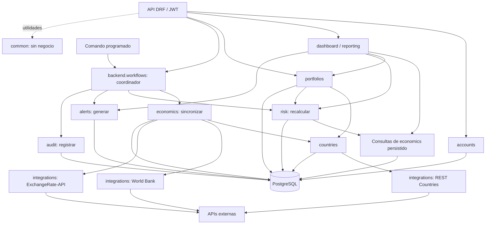

# DataPulse Latam — backend

## risk implementado — 8 de octubre de 2026

El backend incluye `IndiceRiesgo`, cálculo IRPC con evidencia histórica,
ranking, detalle/histórico y recálculo exclusivo ADMIN. El endpoint y los
comandos de sincronización ahora recalculan los países procesados mediante
`backend.workflows`; las alertas siguen pendientes. El admin de riesgo es de
consulta. [Fórmula, decisiones, API y comandos de risk](risk/README.md).

Migración `risk.0001_initial` aplicada a la base local, con un índice calculado
para cada uno de los 10 países. Se conservaron 2 usuarios, 10 monedas, 10 países,
6 tipos, 300 observaciones y 270 cotizaciones. Nueve índices marcan histórico
cambiario incompleto por faltar el extremo inicial de la ventana; Ecuador usa
identidad. No se rellenaron datos ni se reemplazaron observaciones existentes.

Verificación global del historial original: **124 pruebas correctas en
PostgreSQL**, incluidas tres por HTTP real y una de cálculos simultáneos.
Migraciones originales desde cero comprobadas; base temporal eliminada al pasar.
También pasó el modo `--fresh` con 122 pruebas antes de incorporar la prueba
de concurrencia (excluye la prueba de transición original de accounts).
Las notas siguientes conservan el historial de entregas anteriores.

## economics implementado — 8 de octubre de 2026

El backend incluye autenticación, países, monedas, indicadores económicos y
cotizaciones. El segundo ajuste de normalización está implementado:
`TipoIndicador` guarda nombre, unidad y código World Bank; cada observación
referencia ese catálogo. `IndicadorEconomico` es único por país/tipo/año y
`TipoCambio` por par/fecha. Las relaciones están protegidas, las tasas deben
ser positivas y no se almacenan pares idénticos. El catálogo de seis tipos
se precarga con una migración de datos. Los tres modelos tienen Django Admin.

### Ejecutar y probar

Desde `backend`, activar el entorno Python e instalar `requirements.txt`.
Copiar `.env.example` a `.env` y configurar PostgreSQL. No publicar `.env`.

```bash
python -m pip install -r requirements.txt
python manage.py migrate
python manage.py seed_economics
python manage.py runserver
```

`seed_economics` carga los países si faltan, cinco años completos de los seis
indicadores para los diez países (300 observaciones) y 30 días de cotizaciones
para las nueve monedas distintas de USD (270 cotizaciones). Son **datos
simulados**, con `es_simulado=true`; las observaciones tienen fuente MANUAL y
las cotizaciones DEMO_SIMULADO. Ecuador usa identidad USD/USD sin filas de
cotización. La carga conserva registros existentes y puede repetirse.
`--fecha-fin AAAA-MM-DD` fija el último día simulado para una demostración
reproducible. Fechas y años predeterminados se calculan en UTC.

```bash
python manage.py test --noinput
python manage.py verify_migrations --fresh
```

Se verificaron modelos, constraints, filtros, permisos, sincronización parcial,
idempotencia, datos ausentes, conservación de ediciones manuales y errores de
proveedores sobre PostgreSQL de pruebas. La verificación HTTP usa un servidor
real con JWT y base de pruebas; el proveedor de esa prueba está controlado.
También se comprobaron respuestas reales de World Bank y ExchangeRate sin
guardar esos datos en la base principal. El verificador de migraciones incluye
economics y elimina su base temporal cuando pasa.

Resultado del 8 de octubre de 2026: **93 pruebas globales correctas**, incluidas
dos por HTTP real. Cubren también precisión extrema, reintentos HTTP acotados,
respuestas demasiado grandes, salida de comandos ante fallos, reemplazo de
simulaciones y logs estructurados. `verify_migrations` aplicó todas las migraciones
originales desde cero, ejecutó la suite y eliminó la base temporal al pasar.
También se verificó previamente accounts regenerado desde sus modelos actuales.

### API de economics

Todos los endpoints requieren JWT. Las consultas son de lectura para los tres
roles; solo ADMIN puede sincronizar. Ser superusuario Django no concede ese rol.

| Método | Endpoint | Parámetros y respuesta |
| --- | --- | --- |
| GET | `/api/paises/{codigo_iso}/indicadores/` | `tipo`, `anio`, `ordering`, `page`, `page_size`; unidad desde el catálogo. |
| GET | `/api/paises/{codigo_iso}/tipo-cambio/` | `fecha_inicio`, `fecha_fin` (AAAA-MM-DD), `ordering`, `page`, `page_size`. |
| GET | `/api/paises/{codigo_iso}/` | Información general e histórico de indicadores en `indicadores`. |
| POST | `/api/paises/sync-indicadores/` | JSON opcional: `paises`, `anio_inicio`, `anio_fin`. |

Los históricos usan `count`, `next`, `previous`, `results`, con 20 registros por
defecto y máximo 100 por página. Indicadores admite orden por `anio`, `tipo`,
`valor`, `fecha_actualizacion`, `id`; cotizaciones por `fecha`, `tasa`, `id`.
El prefijo `-` indica orden descendente. Parámetros de filtros y orden inválidos
devuelven 400; sin JWT, 401; sin rol, 403; país desconocido/inactivo, 404.

Ejemplo de cuerpo de sincronización:

```json
{"paises": ["CO", "BR"], "anio_inicio": 2021, "anio_fin": 2025}
```

Por defecto consulta los diez países y los últimos cinco años completos; admite
hasta 20 años sin años futuros. Devuelve `creados`, `actualizados`, `sin_cambios`,
`manuales_conservados`, `faltantes`, `paises_procesados`, `errores` y `estado`.
Si todos los países fallan devuelve 503; si procesa alguno devuelve 200, aunque
pueda haber errores/faltantes y `estado=PARCIAL`. Los faltantes se reportan por
país/tipo/año: nunca se convierten en cero ni borran observaciones anteriores.

### Cotizaciones y sincronización

La tasa significa **USD por una unidad de moneda local**: el adaptador invierte
la tasa USD/local del proveedor. La variación es `(tasa_hoy / tasa_ayer - 1) × 100`,
redondeada a seis decimales, y usa el día calendario anterior del mismo par,
incluso si ese día queda fuera del filtro solicitado. Si falta, devuelve
`variacion_porcentual=null` y `dato_anterior_faltante=true`. Por esta convención,
una depreciación de la moneda local produce una variación negativa.

Para USD/USD la API genera una serie de identidad (tasa 1, variación 0, fuente
IDENTIDAD, sin persistencia), de 30 días por defecto y hasta 366 días con filtros.
No es un histórico obtenido de un proveedor.

```bash
python manage.py sync_indicadores
python manage.py sync_indicadores --paises CO BR --anio-inicio 2021 --anio-fin 2025
python manage.py update_tipos_cambio
python manage.py sync_countries
```

Los clientes usan HTTP con timeout de cinco segundos, un reintento ante fallos
de red, 429 y ciertos 5xx, tamaño de respuesta limitado y validación de JSON.
World Bank consulta los seis códigos por país con `source=2` y recorre páginas.
El endpoint limita el presupuesto de consultas a 25 segundos; el comando a
180 por defecto (`--presupuesto 1–600`). Al agotar el presupuesto reporta los
países pendientes para reintentarlos. No crea una cola ni un proceso oculto.
Las llamadas HTTP ocurren fuera de transacciones; cada país/par se guarda
atómicamente con bloqueo para evitar escrituras concurrentes inconsistentes.

Se conservan observaciones MANUAL reales y cotizaciones de otras fuentes
reales; los datos simulados pueden reemplazarse por datos del proveedor.
Valores idénticos no cambian `fecha_actualizacion`. Las cotizaciones usan la
fecha UTC de actualización del proveedor, no la fecha de ejecución; la API
gratuita no proporciona los 30 días históricos, por eso el seed los simula.
Los comandos emiten su resumen y terminan con error si hay fallos parciales.
Las sincronizaciones registran inicio, fin, países y errores en logs JSON.

Contratos consultados: [World Bank](https://datahelpdesk.worldbank.org/knowledgebase/articles/898581-api-basic-call-structures),
[ExchangeRate](https://www.exchangerate-api.com/docs/free) y
[REST Countries v5](https://restcountries.com/docs/countries).
Se usa el endpoint gratuito vigente `https://open.er-api.com/v6/latest/USD`.
El frontend que muestre sus tasas debe incluir la atribución al proveedor.
REST Countries v5 requiere `REST_COUNTRIES_API_KEY`; `sync_countries` conserva
región y moneda principal del enunciado y actualiza nombre oficial, población,
coordenadas, bandera y nombre de moneda. Su contrato se verificó con respuestas
controladas; no se realizó una consulta real con clave propia.

**Siguiente módulo: risk.** El recálculo del IRPC, alertas y auditoría siguen
pendientes. La respuesta de indicadores lo indica con
`recalculo_y_alertas_pendientes=true`; la actualización cambiaria con
`alertas_pendientes=true`. El coordinador se incorporará al implementar esos
módulos. El handler global de errores, throttling y middleware de requests
siguen como requisitos transversales pendientes.

Las secciones posteriores conservan notas de entregas anteriores. Este apartado
y MODELO_DATOS.md describen el estado vigente de economics.

## Diseño normalizado del modelo de datos

El esquema objetivo del monolito modular está en
[MODELO_DATOS.md](MODELO_DATOS.md): tablas, claves, relaciones, restricciones,
campos calculados y decisiones de conservación histórica. Es diseño previo a
la implementación completa; Usuario, Moneda, Pais y los tres modelos de economics ya están implementados. Esta
referencia actualiza las propuestas de datos de las notas históricas de abajo.

## Países y monedas implementados

`countries` contiene Moneda y Pais, relacionados con una FK protegida. Una moneda
puede utilizarse en varios países; su nombre se guarda una sola vez. Los modelos
tienen validadores y constraints para códigos, nombres no vacíos, regiones,
coordenadas y población no negativa. Región tiene índice para consultas.
Ambos modelos están registrados en el admin y se administran mediante los
permisos de Django. La API es de lectura para todos los usuarios autenticados.

| Método | Endpoint | Comportamiento |
| --- | --- | --- |
| GET | `/api/paises/` | Países activos, con paginación y datos de moneda. |
| GET | `/api/paises/{codigo_iso}/` | Información general e indicadores de un país activo; admite código en minúsculas. |

Parámetros del listado:

- `region=ANDINA`: también CONO_SUR, CENTROAMERICA o CARIBE; una región inválida
  devuelve 400 con mensaje en español.
- `search=Colombia`: busca nombre o código de país y nombre o código de moneda.
- `ordering=-poblacion`: campos permitidos nombre, codigo_iso, region y poblacion.
- `page=2&page_size=5`: tamaño por defecto 20 y máximo 100.

La respuesta del listado contiene `count`, `next`, `previous` y `results`.
Cada país expone codigo_iso, nombre, moneda_codigo, moneda_nombre, region,
latitud, longitud, poblacion, bandera_url y activo. Las coordenadas se serializan
como cadenas decimales. Se usa `select_related` para obtener las monedas sin
una consulta adicional por país. Sin JWT devuelve 401; un país inexistente o
inactivo devuelve 404; POST/PUT/PATCH/DELETE autenticados devuelven 405.

Instalación y carga desde el entorno mission, en la carpeta backend:

```bash
python manage.py migrate
python manage.py seed_countries
python manage.py runserver
```

`seed_countries` precarga los 10 países del enunciado y 10 monedas, incluyendo USD.
Es repetible y conserva datos editados. `--update` reemplaza explícitamente los
campos de esos registros con los valores de demostración. Las coordenadas,
monedas y regiones proceden del enunciado; las poblaciones son redondeadas e
ilustrativas, **no datos oficiales actualizados**. Las URLs de banderas apuntan
a FlagCDN; no se descargan imágenes durante la carga. La integración con REST
Countries y los indicadores en el detalle se incorporaron con economics.

Verificación del 8 de octubre de 2026: **44 pruebas pasaron en PostgreSQL
temporal**, incluyendo el historial de migraciones, autenticación, normalización,
restricciones de BD, carga repetible y API de países. También se comprobó HTTP
real con un servidor local y otra base temporal: login, refresh, listado,
detalle, filtros, búsqueda, ordenamiento, paginación y errores 400/401/404/405.
Ambas bases temporales se eliminaron al pasar.

Se aplicó `countries.0001_initial` y la carga inicial en la base principal:
10 países y 10 monedas; los 2 usuarios existentes conservan sus datos.

## Autenticación implementada

### Actualización: identidad únicamente por email

Se eliminó la columna redundante `username` mediante la migración incremental
`accounts.0002_remove_username`, conservando `0001_initial`. Modelo, manager,
serializer y admin usan email; los formularios personalizados ya lo utilizaban.
`get_username()` sigue funcionando: Django devuelve el campo `USERNAME_FIELD`.
El formulario de login del admin conserva el nombre HTML `username`, pero su
valor es el email; esto no implica una columna en la base de datos.

Verificación del 8 de octubre de 2026: **28 pruebas correctas en PostgreSQL**,
incluyendo JWT, login/alta/edición del admin y migración de un usuario existente
con su contraseña, grupos y permisos. Se verificaron las migraciones desde cero
en una base temporal, eliminada al finalizar. Después se aplicó la migración a
la base principal dentro de una transacción: los 2 usuarios existentes conservan
todos sus campos restantes, IDs, hashes y relaciones de permisos. Django no
detectó problemas ni migraciones pendientes.

La eliminación de la columna no ofrece un rollback automático con usuarios
existentes: volver a `0001` requeriría restaurar y rellenar `username` con email
antes de exigir NOT NULL y unicidad. No ejecutar esa reversión directamente.

`AUTH_USER_MODEL = "accounts.User"` está confirmado. El modelo y las migraciones
están sincronizados: `makemigrations --check --dry-run` no detectó cambios y
`migrate` confirmó que no hay migraciones pendientes. La prueba original de
creación se ejecutó antes de implementar los endpoints y pasó.

Ya existe un superusuario activo en la base principal, que se conserva. En una
base de pruebas se verificó además que el comando estándar `createsuperuser`
crea un superusuario sin pedir username y que puede autenticarse mediante email
y contraseña. No se cambiaron credenciales de usuarios existentes.

| Método | Endpoint | Acceso y comportamiento |
| --- | --- | --- |
| POST | `/api/auth/register/` | Público. Crea un usuario VIEWER y responde con su perfil (201). |
| POST | `/api/auth/login/` | Público. Email y contraseña; devuelve access y refresh (200). |
| POST | `/api/auth/refresh/` | Público. Recibe refresh válido y devuelve un access nuevo (200). |
| GET | `/api/auth/me/` | JWT. Devuelve únicamente el perfil del usuario autenticado. |
| PUT | `/api/auth/me/` | JWT. Requiere email y nombre completo; contraseña opcional. |

Registro:

```json
{
  "email": "persona@example.com",
  "nombre_completo": "Nombre Completo",
  "password": "MiClaveSegura!739x"
}
```

Login:

```json
{"email": "persona@example.com", "password": "MiClaveSegura!739x"}
```

Renovación:

```json
{"refresh": "TOKEN_REFRESH_RECIBIDO_EN_LOGIN"}
```

Para GET y PUT enviar `Authorization: Bearer TOKEN_ACCESS`. El access dura
5 minutos y el refresh 1 día. No hay rotación de refresh ni endpoint de logout
en esta entrega. Los tokens guardan el ID del usuario, por lo que cambiar el
email no altera la identidad autenticada. El login normaliza email y respeta
literalmente los espacios de la contraseña.

PUT permite cambiar `email`, `nombre_completo` y, opcionalmente, `password`.
El email debe ser único tras normalizarlo y es la única identidad de acceso.
La contraseña se valida con la política Django y se guarda mediante hash.
Al cambiarla se invalidan access y refresh anteriores: iniciar sesión de nuevo.
PATCH y DELETE no están habilitados.

`id`, `rol`, `fecha_creacion` y `activo` son de solo lectura; si se envían, DRF
los ignora. Los flags internos de Django y username no están expuestos. El
registro siempre crea VIEWER activo sin permisos de staff/superusuario. La
administración de roles y activación permanece en el admin, con acceso explícito
solo para superusuarios Django.

Errores de entrada y email duplicado devuelven 400. Credenciales incorrectas,
usuario inactivo, token ausente/inválido/caducado, refresh de usuario eliminado
o tokens anteriores a un cambio de contraseña devuelven 401. Las contraseñas
nunca aparecen en las respuestas.

Validación de esta entrega: **25 tests pasaron en PostgreSQL**, incluidos el
test original de persistencia, comando createsuperuser, registro, login, refresh,
perfil, protección de roles/activación/permisos, email duplicado, expiración,
contraseñas incorrectas e invalidación de tokens. Django creó y eliminó una base
de pruebas separada. Para repetir:

```bash
python manage.py test accounts --noinput
```

`countries` y `economics` ya están implementados; el siguiente módulo es `risk`.

## Actualización: migraciones y prueba completadas

### Comprobación con migraciones regeneradas desde cero

El 8 de octubre de 2026 se verificó también el modelo actual en una base
PostgreSQL nueva y vacía, sin utilizar el historial de migraciones de accounts.
Se generó una nueva `0001_initial` en un paquete temporal vacío, se aplicó esa
migración junto a las migraciones de Django y se confirmó que `accounts_user`
no contiene la columna `username`. No hubo cambios de modelo sin migración ni
migraciones pendientes, y los checks de Django pasaron.

Las **27 pruebas funcionales** de modelos, autenticación JWT y admin pasaron
sobre esa base. La prueba de transición `0001` → `0002` se excluye de este modo
porque la nueva base solo tiene una migración inicial; ya se verificó por separado
con el historial incremental. La base temporal se eliminó al pasar. La base
principal y los archivos de migración originales se conservaron.

Para repetir desde el entorno mission, dentro de backend:

```bash
python manage.py verify_migrations --fresh
```

Sin `--fresh`, el comando sigue comprobando el historial original y las 28 pruebas.

Tras configurar PostgreSQL y habilitar el admin, se avanzó a la fase 2:
se creó y revisó `accounts/migrations/0001_initial.py`, se aplicaron todas las
migraciones pendientes en `datapulse` y se ejecutó `manage.py test accounts`.
Resultado: **1 prueba correcta**, utilizando una base de pruebas separada que
Django creó y eliminó al finalizar. No se borraron datos ni se reinició la base.
El intento previo de `migrate` había aplicado solo `contenttypes.0001_initial`;
al crear la migración de accounts, Django pudo ordenar y completar las restantes.
Ya se puede ejecutar `python manage.py createsuperuser` para acceder al admin.
Las notas de fase 1 de abajo describen el estado anterior a esta actualización.

### Verificación adicional en una segunda base vacía

El 8 de octubre de 2026 se creó `datapulse_prueba` usando el rol existente
configurado en el entorno. Se regeneró la migración inicial de accounts en un
paquete temporal, sin sustituir los archivos del proyecto. Después se verificó
que los modelos actuales no requieren nuevas migraciones y se aplicaron las
19 migraciones del proyecto/Django desde cero en esa segunda base, sin errores.
`migrate --check` y `check --database default` pasaron. La prueba de creación de
usuario también pasó sobre `datapulse_prueba`, usando `TestCase` y conservando
la base al finalizar. El usuario de la prueba se revirtió: quedaron 0 usuarios.

La base `datapulse_prueba` se eliminó después de completar esta verificación,
según la preferencia de conservar bases de prueba solo si hay errores.
El `.env` y la base principal `datapulse` no se modificaron.

Para repetir la verificación completa desde el entorno mission:

```bash
python manage.py verify_migrations
```

Este comando crea una base `datapulse_prueba_<identificador>` nueva en cada
ejecución, regenera la migración inicial de accounts en una carpeta temporal,
comprueba cambios pendientes, aplica las migraciones reales desde cero y ejecuta
los tests sobre esa base. Si todo pasa, la elimina automáticamente y comprueba
que ya no exista. Si falla una comprobación, conserva la base e informa su nombre
para diagnosticar el problema. Requiere un rol con permisos para crear bases.

## Implementado

Proyecto Django 5.2 con DRF, PostgreSQL y autenticación JWT configurada en DRF.
`AUTH_USER_MODEL = "accounts.User"` está definido antes de cualquier migración.
Las apps de negocio actuales son `accounts` (autenticación/perfil) y `countries`
(países y monedas). `common.pagination` proporciona paginación reutilizable.
Los usuarios están registrados en `/admin/`, con formularios de creación por
email, nombre completo y contraseña confirmada, edición y cambio de contraseña.
Solo los superusuarios Django pueden gestionar este panel de usuarios, que incluye
roles, activación y permisos internos; el rol de negocio ADMIN no concede acceso.
Los formularios normalizan el email antes de validar unicidad y `save()` conserva
esa normalización. Las contraseñas usan los formularios seguros y validadores de Django.

```text
backend/
├── .env.example
├── requirements.txt
├── README.md
├── manage.py
├── backend/
│   ├── settings.py
│   ├── urls.py
│   ├── asgi.py
│   └── wsgi.py
└── accounts/
    ├── __init__.py
    ├── apps.py
    ├── admin.py
    ├── forms.py
    ├── managers.py
    ├── models.py
    ├── serializers.py
    ├── urls.py
    ├── views.py
    └── tests/
        ├── __init__.py
        ├── test_auth_api.py
        └── test_models.py
```

### Identidad, permisos y contraseñas

- El login usa `email` (`USERNAME_FIELD`); `REQUIRED_FIELDS` está vacío. El manager
  acepta email y contraseña, valida el email y usa `set_password()`.
- Decisión propuesta: toda la dirección se convierte a minúsculas y se eliminan
  espacios exteriores. La búsqueda de autenticación mediante la clave natural
  aplica la misma normalización. El serializer normaliza antes de verificar
  unicidad y excluye al propio usuario durante una actualización.
- `username` se eliminó: email es la única identidad persistida. El manager y
  `save()` normalizan el email, también al guardar parcialmente con
  `update_fields=['email']`. Las futuras rutas deben usar este
  serializer o un servicio equivalente; `QuerySet.update()`, `bulk_create()` y
  `bulk_update()` omiten `save()` y no deben usarse para modificar la identidad.
  Las escrituras concurrentes siguen protegidas por la unicidad de la BD; las
  futuras vistas deberán convertir un conflicto `IntegrityError` en un error API.
- `nombre_completo` y `fecha_creacion` sustituyen `first_name`, `last_name` y
  `date_joined`, evitando datos equivalentes independientes. Los métodos de nombre
  de Django se adaptan al campo del negocio.
- `is_active` es el único estado: su columna será `activo` y el serializer lo
  publica como `activo`, de solo lectura. Django y JWT usan `is_active`.
- `rol` es de solo lectura en este serializer y su valor inicial es `VIEWER`.
  Los campos recibidos de solo lectura se ignoran según la convención DRF.
  `is_staff`, `is_superuser` y `username` no se exponen. No hay `points` ni `is_admin`.
  La gestión de roles y activación necesita un endpoint/serializer administrativo
  separado con permisos explícitos. El rol ADMIN no concede permisos Django.
- `create_superuser()` valida `is_staff`, `is_superuser` e `is_active`, exige una
  contraseña y no pide username. Para compatibilidad con el comando estándar,
  usa el email normalizado como nombre completo inicial si no se proporciona.
  Es una decisión pendiente de revisar antes de habilitar la administración.
  Ser superusuario no cambia automáticamente el rol de negocio VIEWER.
- La contraseña es de escritura solamente y se cifra mediante el hash de Django.
  Registro y cambios pasan por `validate_password()`; el manager aplica la misma
  política. Mínimo 6 caracteres, sin contraseñas comunes, enteramente numéricas
  o similares al usuario. Se conservan los espacios de la contraseña.
  `create_user(password=None)` admite una contraseña inutilizable para usos
  internos; el registro requiere contraseña. Una edición parcial puede omitirla;
  si se envía una nueva, se usa `set_password()`.

Referencias de las decisiones de integración:
[usuario personalizado](https://docs.djangoproject.com/en/5.2/topics/auth/customizing/) y
[validación de contraseñas](https://docs.djangoproject.com/en/5.2/topics/auth/passwords/).

### Entorno y estado de la base de datos

`requirements.txt` define rangos compatibles. Instalar en un entorno virtual con
`python -m pip install -r requirements.txt`. Django carga automáticamente
`backend/.env` (junto a `manage.py`) mediante `python-dotenv`, antes de leer su
configuración. `.env.example` es la plantilla compartida. El archivo `.env` está
ignorado por Git y contiene las credenciales locales; completa `POSTGRES_PASSWORD`
con la contraseña de PostgreSQL. El archivo local usa la base `datapulse` y el
rol existente `postgres`. Las variables ya exportadas en el proceso tienen
prioridad sobre `.env`; elimínalas con `unset` o abre una terminal nueva si quieres
usar exclusivamente el archivo. No se interpolan variables dentro de sus valores,
para conservar literalmente contraseñas que contengan `$`.
PostgreSQL es el único motor configurado. La clave local predeterminada solo sirve
para desarrollo; fuera de desarrollo se exige `DJANGO_SECRET_KEY` y configurar
los hosts permitidos.

Al inspeccionar el proyecto no había migraciones propias ni tablas SQLite:
`db.sqlite3` es un archivo de 0 bytes, que se conserva sin cambios. Las migraciones
incluidas en las dependencias Django no son migraciones creadas para este proyecto.
No se consultó PostgreSQL: su disponibilidad y posible esquema preexistente quedan
pendientes de revisión antes de migrar. No se borraron ni reiniciaron bases de datos.

### Prueba escrita y límite de esta fase

`accounts/tests/test_models.py` usa `django.test.TestCase` y el manager, con email,
nombre y contraseña. Recupera el usuario desde la BD de pruebas y comprueba email
normalizado, nombre, username, identificador de login, rol VIEWER, activación,
fecha automática, hash, contraseña correcta e incorrecta y representación textual.
En fase 1 el test se dejó pendiente; ahora se ha ejecutado correctamente, como
se indica en la actualización. No se sustituye persistencia por mocks.

Solo se permiten comprobaciones sin tablas: sintaxis, imports y `manage.py check`
sin `--database`. No ejecutar `makemigrations`, `migrate` ni la suite de pruebas
hasta la fase explícita de migraciones descrita más abajo.

Comprobaciones realizadas en esta entrega, con dependencias instaladas en un
entorno virtual temporal:

- Compilación de sintaxis de `accounts` y configuración: correcta.
- `manage.py check`: sin incidencias (0 silenciadas), sin solicitar checks de BD.
- Imports de modelo, manager, serializer, módulo del test y componentes JWT:
  correctos. Se comprobó que ninguna conexión de BD estaba abierta.
- Metadatos: usuario personalizado, login por email, columna `activo`, campos
  protegidos del serializer y campo de login del serializer JWT: correctos.
- `git diff --check`: sin errores de formato.

No se ejecutaron tests, `makemigrations` ni `migrate`; no se comprobó persistencia.

## Arquitectura propuesta — no implementada

Monolito modular con ORM Django y PostgreSQL. Crear solo las capas que sean
necesarias; no añadir repositorios que dupliquen el ORM.

```text
backend/
├── backend/                  Configuración y rutas generales
│   └── workflows.py          Futuro coordinador de procesos entre módulos
├── accounts/                 Identidad, JWT, perfil y roles
├── countries/                Países y monedas
├── economics/                Indicadores y cotizaciones almacenadas
├── portfolios/               Portafolios, posiciones y métricas
├── risk/                     IRPC y resultados históricos
├── alerts/                   Alertas y lecturas por usuario
├── audit/                    Registro de actividad
├── dashboard/                KPIs, mapas y tendencias
├── reporting/                Reportes PDF
├── common/                   Paquete Python, sin reglas de negocio
└── integrations/             Paquete Python, sin acceso a la BD
    ├── world_bank.py
    ├── exchange_rate.py
    └── rest_countries.py
```

Capas según necesidad dentro de cada app: `models.py` (persistencia/restricciones),
`serializers.py` (entrada/salida), `services.py` (negocio/transacciones),
`selectors.py` (consultas reutilizables), `permissions.py`, `views.py` (coordinación
HTTP), `urls.py`, `tests/` y `migrations/` cuando corresponda.
`accounts` incluye además el manager específico de Django.

| Módulo | Responsabilidad y dependencias propuestas |
| --- | --- |
| accounts | Usuarios, autenticación, perfil y roles; permisos de negocio separados de Django. |
| countries | Países/monedas; consume REST Countries mediante integrations; valida y persiste. |
| economics | Indicadores, cotizaciones e históricos; depende de countries y clientes World Bank/ExchangeRate-API; valida y persiste. |
| portfolios | Propiedad, posiciones, montos, monedas y métricas; usa countries y consultas públicas de risk. |
| risk | Calcula IRPC a partir de economics persistido; guarda desglose e históricos; nunca consulta APIs externas. |
| alerts | Persistencia de alertas y lecturas por usuario; recibe resultados del coordinador. |
| audit | Persiste actividad solicitada explícitamente por servicios/coordinador. |
| dashboard | Agrega consultas de countries, economics, risk, portfolios y alerts. |
| reporting | Genera PDF reutilizando consultas y servicios del negocio. |
| common | Paginación, errores y utilidades compartidas; no depende de apps de negocio. |
| integrations | HTTP con timeouts, reintentos limitados y normalización; devuelve datos, sin ORM ni decisiones de negocio. |

Modelos relacionados usarán `settings.AUTH_USER_MODEL`; obtener la clase en tiempo
de ejecución con `get_user_model()`. No importar directamente un User concreto
fuera de su módulo.

### Coordinación sin ciclos

Un futuro coordinador de aplicación en `backend/workflows.py`, invocado por un
comando de gestión y después por una vista administrativa, ejecutará:
sincronización → recálculo del riesgo → generación de alertas → auditoría.
Depende de servicios públicos de economics, risk, alerts y audit; estos módulos
no importan el coordinador. Así economics no depende de risk/alerts y risk no
necesita importar alerts. Los clientes externos operan fuera de transacciones
largas. Cada etapa persiste de forma acotada e informa fallos parciales; se deberá
acordar idempotencia, manejo de reintentos y criterios para recalcular/alertar.
Empezar con comandos programados; Celery/Redis solo si la ejecución asíncrona
es indispensable para el alcance de la prueba.



### Orden posterior y presupuesto propuesto (~60 horas)

| Fase | Entrega | Horas |
| --- | --- | ---: |
| 1 | Configuración, User, manager, serializer y test escrito (actual). | 4 |
| 2 | Revisar modelos y BD existente; crear/revisar migración inicial de accounts; ejecutar migraciones en PostgreSQL; ejecutar test de creación y ampliar pruebas de manager/serializer. | 4 |
| 3 | Registro, login/refresh JWT, perfil, permisos y administración separada de roles; pruebas de seguridad. | 6 |
| 4 | countries e integrations; economics y sincronización con fallos parciales. | 10 |
| 5 | risk: fórmula acordada, desglose y pruebas deterministas. | 6 |
| 6 | portfolios: posiciones, validaciones, propiedad, concurrencia y métricas. | 8 |
| 7 | alerts, audit y coordinación programada con idempotencia. | 6 |
| 8 | dashboard y reporting PDF reutilizando consultas. | 7 |
| 9 | Pruebas integradas, datos de demostración, documentación y despliegue. | 9 |

Esta distribución corresponde al backend; si las 60 horas incluyen también el
frontend, habrá que reducir alcance y reservar tiempo para él.

### Decisiones pendientes y discrepancias

- No se adjuntó el documento original de la prueba técnica. Se recibió este prompt
  y existe `../ARQUITECTURA.md`; las afirmaciones sobre la prueba en ese documento
  no se han contrastado con su fuente original.
- El proyecto usaba SQLite; el requisito pide PostgreSQL. Se actualiza la
  configuración y se conserva el archivo vacío.
- `REQUIRED_FIELDS = []` hace que el comando no solicite `nombre_completo`, aunque
  es obligatorio. Solución provisional: nombre inicial igual al email únicamente
  para superusuarios. El registro público siempre exige el nombre real.
- El ejemplo exige mínimo 6; Django tenía mínimo 8. Se fija 6 en ambos lugares y
  se conservan los otros validadores. Confirmar si la prueba exige solo longitud.
- Se elige identidad de email sin mayúsculas; confirmar esta política y límites
  de nombres antes de crear la migración inicial.
- La arquitectura previa atribuye a servicios económicos/riesgo la creación de
  alertas; aquí se propone concentrar esa coordinación en workflows para evitar
  ciclos. Este diseño aún no existe en código.
- La arquitectura previa menciona una discrepancia de inflación del IRPC:
  9,2 % penalizado con -10 en algoritmo y -25 en ejemplo. No es posible verificarla
  sin el enunciado; acordar fórmula antes de implementar risk.
- Acordar permisos por rol/propiedad, proveedores/cuotas, umbrales de alertas,
  cotizaciones e históricos, datos faltantes, CORS para Angular y despliegue.
- En fase 2, comprobar si PostgreSQL contiene datos o migraciones aplicadas antes
  de cambiar nada. No borrar migraciones ni reiniciar esquemas existentes.

La implementación se detiene al terminar la fase 1.
