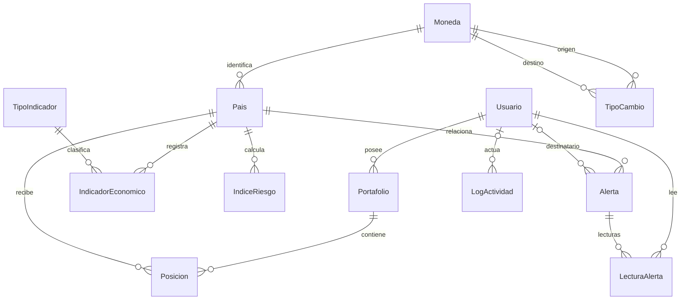

# DataPulse Latam - backend

API Django 5.2 + Django REST Framework, JWT y PostgreSQL para monitoreo económico,
riesgo país, alertas y portafolios. Monolito modular; los proveedores externos se
consultan durante sincronizaciones y las lecturas usan datos persistidos.

## Estado actual

Implementados: accounts, countries, economics, risk, alerts, portfolios, audit,
dashboard y reporting. No se agregaron tablas ni migraciones para dashboard/PDF:
consumen el modelo existente. Errores uniformes en español, throttling, logs JSON
de requests y CORS configurable están conectados a la API completa.

Se entrega arranque Gunicorn, WhiteNoise para estáticos, Dockerfile y plantillas
de tareas programadas. Publicación/URL pública pendiente de proveedor y cuenta.
REST Countries real pendiente de su clave; el contrato y fallos se prueban con
respuestas controladas. El frontend y su publicación tienen seguimiento separado.

## Instalación local reproducible

Requiere Python 3.12+ y PostgreSQL accesible. Crear una base vacía y un rol con
permisos de conexión/migración. Para verificar pruebas, ese rol debe poder crear
bases temporales (`CREATEDB`). Trabajar desde la carpeta backend:

```bash
python -m venv .venv
. .venv/bin/activate
pip install -r requirements-dev.txt
cp .env.example .env
```

Completar POSTGRES_DB/USER/PASSWORD/HOST/PORT y DJANGO_SECRET_KEY en `.env`.
Las variables exportadas por el proceso tienen prioridad sobre el archivo; no
se interpolan caracteres `$` dentro de valores. `.env` está ignorado por Git.

```bash
python manage.py check
python manage.py migrate
python manage.py seed_data
python manage.py runserver
```

API local: `http://127.0.0.1:8000/api/`. Documentación: `/api/docs/` y
[contrato completo](API.md). Health: `/health/`. Admin: `/admin/`; crear un
superusuario propio con `python manage.py createsuperuser` si se necesita acceder.
El rol ADMIN de negocio no concede automáticamente is_staff/is_superuser.

## Datos de demostración

`seed_data` crea las tres identidades exigidas por la prueba:

| Email | Rol | Contraseña de demostración |
| --- | --- | --- |
| admin@datapulse.com | ADMIN | DataPulse2026! |
| analista@datapulse.com | ANALISTA | DataPulse2026! |
| viewer@datapulse.com | VIEWER | DataPulse2026! |

También carga 10 países, 300 observaciones (6 indicadores por país durante cinco
años), 279 cotizaciones (31 por cada una de nueve monedas distintas de USD), dos
portafolios con cuatro posiciones para ANALISTA e índices calculados para los diez
países. Ecuador/USD se resuelve como identidad sin persistir USD/USD.

El seed es repetible, conserva usuarios/registros existentes y crea cálculos
solo si añadió datos o faltan países con índice. Si una identidad DEMO ya existe
con otro rol, estado o contraseña, aborta de forma explícita sin resetearla.
La contraseña fija del enunciado es una excepción acotada a estas cuentas; la
política de registro y perfil sigue activa. Poblaciones e históricos son
ilustrativos, los indicadores/cotizaciones tienen `es_simulado=true`.

Los comandos individuales permiten cargar por etapas:

```bash
python manage.py seed_countries
python manage.py seed_economics
python manage.py seed_portafolios --usuario analista@datapulse.com
python manage.py calcular_riesgos
```

31 cotizaciones permiten 30 variaciones diarias. El seed anterior de 30 se amplía
sin cambiar sus valores; datos manuales reales nunca se sustituyen por simulación.
Las alertas se generan desde eventos reales del sistema: un dataset estable puede
tener un panel vacío. No se insertan alertas ficticias como si fueran reales.

## Arquitectura y modelo

```text
HTTP/JWT -> views/serializers/permisos -> servicios/selectors -> ORM -> PostgreSQL
                       |                     |
                dashboard/reporting     backend.workflows
                                       /       |        \
                                economics     risk     alerts -> audit
                                    |
                               integrations -> proveedores HTTP
```

| Módulo | Responsabilidad |
| --- | --- |
| accounts | Identidad por email, JWT, perfil y roles. |
| countries | Países y catálogo de monedas. |
| economics | Indicadores, cotizaciones, historial y sincronización. |
| risk | IRPC versionado y evidencia histórica reproducible. |
| alerts | Eventos idempotentes y lecturas independientes por usuario. |
| portfolios | Posiciones, validaciones, colaboración y versiones. |
| audit | Actividad explícita con metadatos tipados sin secretos. |
| dashboard | KPI, mapa y series de cinco años. |
| reporting | PDF a partir de una instantánea autorizada. |
| common | Infraestructura compartida; no importa reglas de negocio. |
| integrations | HTTP, timeouts y reintentos; no accede al ORM. |



Diccionario y constraints en [MODELO_DATOS](MODELO_DATOS.md). Separar Moneda,
TipoIndicador y LecturaAlerta elimina nombres/unidades duplicados y evita que la
lectura de una alerta global afecte a otras personas. `leida`, nivel/color y
variación cambiaria se derivan para la API; montos/cotizaciones usan Decimal.

Diagrama generado desde los modelos: [SVG normalizado](docs/modelo-normalizado.svg).

Se elige PostgreSQL por constraints, bloqueos de fila y concurrencia. Se evitan
repositorios que dupliquen el ORM, microservicios sin necesidad comprobada y
Celery/Redis hasta requerir una cola. Los comandos Django están permitidos por
la prueba. ReportLab genera PDF sin navegador ni servicio externo; CORS y estáticos
se resuelven con django-cors-headers y WhiteNoise; Gunicorn sirve WSGI.

## Permisos, concurrencia y riesgo

JWT activo requerido para los datos. VIEWER consulta propios/públicos y exporta,
pero no modifica. ANALISTA crea y edita propios/públicos; privados ajenos no son
visibles. ADMIN accede a todos los portafolios. Solo propietario con escritura o
ADMIN elimina/cambia visibilidad. Alertas privadas son solo del destinatario.

Cada cambio de portafolio/posición requiere `version`, bloquea el portafolio y
valida permisos y límites dentro de una transacción; éxito incrementa la versión,
conflicto devuelve 409. El cliente debe recargar/revisar, sin sobrescritura automática.

IRPC usa pesos 0.40/0.30/0.30 y niveles BAJO >=75, MODERADO >=50, ALTO >=25,
CRITICO <25. Datos ausentes se señalan, nunca se convierten en cero. Últimos años
completos UTC, volatilidad poblacional y depreciación del par local -> USD.
La fórmula del enunciado resta 10 puntos para inflación 9,2 %, mientras su ejemplo
resta 25: se aplica la fórmula y se documenta la discrepancia y un ejemplo coherente
en [risk](risk/README.md). Un score alto con evidencia incompleta debe mostrarse
junto a esa advertencia.

## Sincronización y errores

```bash
python manage.py sync_indicadores
python manage.py sync_indicadores --paises CO BR --anio-inicio 2021 --anio-fin 2025
python manage.py update_tipos_cambio
python manage.py sync_countries
```

World Bank y ExchangeRate tienen timeouts, reintentos acotados y fallos parciales
por país. REST Countries v5 requiere REST_COUNTRIES_API_KEY. Se guardan primero
datos válidos y workflows coordina recálculo, alertas y auditoría. El endpoint
ADMIN tiene presupuesto de 25 segundos; el comando de indicadores 180 por defecto.
Los comandos señalan fallo si quedan etapas pendientes. Simulaciones pueden
reemplazarse por datos externos; ediciones manuales reales se conservan.

Errores DRF comparten `error.codigo/mensaje/detalles`; se conservan los campos
originales para compatibilidad. 500 no publica excepciones. Logs JSON incluyen
método, ruta sin query, actor autenticado, duración y estado, sin cuerpos/tokens.
Auditoría registra CRUD, consultas, login, tareas y exportación. Throttling 100/min
por usuario y 20/min por IP anónima; `Retry-After` en 429. CORS solo permite los
orígenes configurados. Detalles en [API](API.md) y [common](common/README.md).

## Pruebas y migraciones

```bash
python manage.py test --noinput
python manage.py test dashboard reporting common --noinput
python manage.py makemigrations --check --dry-run
python manage.py verify_migrations
python manage.py verify_migrations --fresh
```

El runner aísla la caché entre pruebas, manteniendo límites activos dentro de cada
escenario. PostgreSQL temporal y LiveServer comprueban persistencia, JWT/HTTP,
permisos, faltantes, umbrales, concurrencia, PDF y validaciones.
`verify_migrations` crea una base nueva, aplica/verifica migraciones y prueba todo;
la elimina al pasar y la conserva ante fallos para diagnóstico. `--fresh` genera
accounts en un paquete temporal, sin modificar migraciones del repositorio.

Verificación del 8 de octubre de 2026: **245 pruebas globales correctas**, con
migraciones originales desde cero; **244** con accounts regenerado (se excluye
la prueba incremental que depende de su historial original). Siete flujos HTTP
reales y escenarios concurrentes. Bases temporales exitosas eliminadas.
Configuración Gunicorn y `check --deploy` con variables de producción correctos;
el PDF de ejemplo se renderizó y revisó visualmente con fuentes incrustadas.

Conservar migraciones aplicadas y la base principal. La consolidación documental
preserva las notas anteriores en [historial](docs/HISTORIAL.md); contiene estados
históricos y no sustituye este README como referencia actual.

## Despliegue

[Guía de producción](deployment/README.md): variables, arranque, HTTPS,
PostgreSQL, health, Docker y plantillas systemd para comandos diarios. El seed
de entrega se ejecuta explícitamente, no durante cada arranque.
La URL pública se documentará tras una publicación real; no hay un proveedor
ni remoto Git configurados en el estado actual del proyecto.
