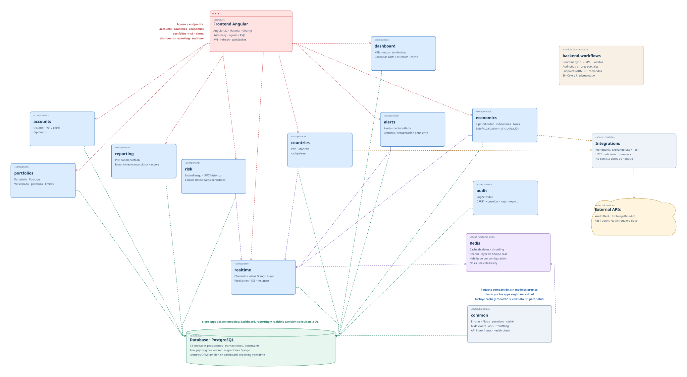
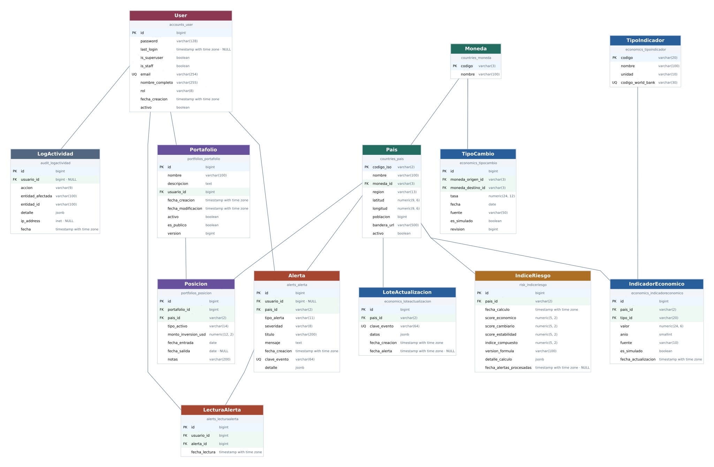

# DataPulse Latam

Plataforma de monitoreo económico de diez países latinoamericanos, cálculo del
índice de riesgo país (IRPC), alertas y portafolios de inversión simulados.
Backend Django/DRF y PostgreSQL; frontend Angular con Material y Chart.js.
Incluye exportación PDF y notificaciones en tiempo real mediante Redis/WebSockets.

Código fuente: [cfrodriguezb17/mission](https://github.com/cfrodriguezb17/mission).

## 1. Arquitectura de la solución

La solución utiliza un monolito modular Django, una SPA Angular y PostgreSQL.
Los módulos del backend separan identidad, países, indicadores, riesgo,
portafolios, alertas, dashboard, reportes y auditoría.

Angular consulta la API REST con JWT. Los servicios de negocio validan las
operaciones y persisten sus resultados en PostgreSQL. Las sincronizaciones
consumen World Bank, ExchangeRate y REST Countries; las pantallas consultan
datos guardados, sin depender de una llamada externa en cada visita.
Redis comparte caché y avisos entre workers; Uvicorn y Channels atienden las
conexiones en vivo. Las notificaciones se publican después del commit.



[Abrir diagrama de arquitectura](diagrama-de-arquictectura.svg).
El detalle de módulos, dependencias y consistencia está en
[ARQUITECTURA.md](ARQUITECTURA.md).

## 2. Diagrama Entidad-Relación de la base de datos

El modelo relaciona usuarios, países y monedas con indicadores económicos,
cotizaciones, índices de riesgo, portafolios, posiciones y alertas.
Las lecturas de alertas son independientes por usuario; los lotes de actualización
conservan evidencia para recuperar alertas pendientes. LogActividad registra las
acciones auditadas.



[Abrir diagrama Entidad-Relación](diagrama-entidad-relacion-base-de-datos.svg).
Consultar [el modelo de datos](backend/MODELO_DATOS.md) para campos,
restricciones, precisión monetaria y reglas de concurrencia.

## 3. Decisiones técnicas

[decisiones-tecnicas.md](decisiones-tecnicas.md) explica por qué se eligió cada
herramienta del backend y sus alternativas. Incluye monolito modular,
PostgreSQL, pool de conexiones, SimpleJWT, comandos programados, Redis,
ASGI/Channels, ReportLab, documentación OpenAPI y despliegue.

El documento excluye las herramientas obligatorias de la prueba y distingue
las alternativas documentadas de las comparaciones propuestas.

## 4. Instalación y ejecución local paso a paso

### 4.1. Requisitos

Instalar Git, Python 3.12+, PostgreSQL con sus herramientas de cliente,
Node.js 24 compatible con Angular 22 y pnpm 11.24.0. El entorno documentado
utiliza Node 24.20. Para el arranque conjunto se necesita Linux, Bash 4.3+,
`setsid` (util-linux) y `curl`.

PostgreSQL debe estar iniciado. Redis es opcional para la navegación local:
habilita caché compartida y notificaciones en vivo; sin él, el frontend
consulta alertas periódicamente.

### 4.2. Obtener el código e instalar pnpm

```bash
git clone https://github.com/cfrodriguezb17/mission.git
cd mission
npm install --global pnpm@11.24.0
```

Si ya se dispone de esta carpeta de entrega, comenzar desde su raíz.
En los pasos siguientes, la raíz es la carpeta que contiene `backend/`,
`frontend/` y `run-local.sh`.

### 4.3. Crear el usuario y la base PostgreSQL

En Linux, con acceso administrativo local a PostgreSQL:

```bash
sudo -u postgres createuser --pwprompt --createdb datapulse
sudo -u postgres createdb --owner=datapulse datapulse
```

El primer comando solicita la contraseña del nuevo rol; usar esa misma
contraseña en `POSTGRES_PASSWORD` del paso siguiente. El permiso `CREATEDB`
permite ejecutar las pruebas en bases temporales.

En otros entornos, crear el rol y la base desde el cliente administrativo de
PostgreSQL. Si ya existen, reutilizarlos y comprobar que el rol tiene permisos
sobre la base; para pruebas necesita también `CREATEDB` y acceso a la base
de mantenimiento `postgres`.

### 4.4. Preparar el backend

Desde la raíz:

```bash
cd backend
python3 -m venv .venv
. .venv/bin/activate
python -m pip install -r requirements-dev.txt
cp .env.example .env
python -c 'import secrets; print(secrets.token_urlsafe(48))'
```

Copiar la clave generada a `DJANGO_SECRET_KEY` y editar `backend/.env`.
Completar los valores siguientes, sustituyendo la clave y la contraseña:

```dotenv
DJANGO_DEBUG=true
DJANGO_SECRET_KEY=CLAVE_GENERADA_EN_EL_PASO_ANTERIOR
DJANGO_ALLOWED_HOSTS=localhost,127.0.0.1
POSTGRES_DB=datapulse
POSTGRES_USER=datapulse
POSTGRES_PASSWORD=CONTRASENA_DEL_ROL_POSTGRESQL
POSTGRES_HOST=127.0.0.1
POSTGRES_PORT=5432
CORS_ALLOWED_ORIGINS=http://localhost:4200,http://127.0.0.1:4200
DJANGO_SECURE_SSL_REDIRECT=false
```

Conservar el resto de valores de la plantilla. Las variables exportadas en la
terminal tienen prioridad sobre `.env`. La clave `REST_COUNTRIES_API_KEY`
solo es necesaria para sincronizar ese proveedor; la precarga y las lecturas
locales funcionan sin ella.

Para usar un Redis local iniciado en el puerto 6379, configurar además:

```dotenv
DJANGO_REDIS_URL=redis://127.0.0.1:6379/0
DJANGO_REALTIME_REDIS_URL=redis://127.0.0.1:6379/0
```

Desde `backend/`, con el entorno virtual activo:

```bash
python manage.py check
python manage.py migrate
python manage.py seed_data
cd ..
```

La precarga crea los usuarios DEMO, diez países, cinco años de seis indicadores,
31 cotizaciones por moneda no USD, dos portafolios y los índices de riesgo.
Los históricos simulados se identifican como tales. El seed conserva registros
existentes y aborta si una identidad DEMO existente tiene datos incompatibles.

### 4.5. Preparar el frontend

Desde la raíz:

```bash
cd frontend
pnpm install --frozen-lockfile
cd ..
```

La configuración de desarrollo utiliza `http://127.0.0.1:8000/api`.
Puede cambiarse en
[environment.ts](frontend/src/environments/environment.ts).

### 4.6. Iniciar la aplicación

Desde la raíz, después de preparar ambos proyectos:

```bash
./run-local.sh
```

El script comprueba dependencias, puertos, conexión a PostgreSQL y migraciones.
Inicia ambos servicios con recarga automática; Ctrl+C detiene los dos.
No instala dependencias ni aplica migraciones o seed automáticamente.

| Recurso local | Dirección |
| --- | --- |
| Frontend | [http://localhost:4200](http://localhost:4200) |
| API | [http://127.0.0.1:8000/api/](http://127.0.0.1:8000/api/) |
| Swagger | [http://127.0.0.1:8000/api/swagger/](http://127.0.0.1:8000/api/swagger/) |
| Salud de PostgreSQL | [http://127.0.0.1:8000/health/](http://127.0.0.1:8000/health/) |

También se pueden iniciar en terminales separadas, desde la raíz.
Backend:

```bash
cd backend
. .venv/bin/activate
python -m uvicorn backend.asgi:application --host 127.0.0.1 --port 8000 --reload --lifespan off --no-proxy-headers
```

Frontend, en otra terminal:

```bash
cd frontend
pnpm start
```

Guías específicas: [backend](backend/README.md) y [frontend](frontend/README.md).

## 5. Instrucciones para ejecutar tests

### Backend

Desde la raíz, con PostgreSQL iniciado y el rol de pruebas configurado:

```bash
cd backend
. .venv/bin/activate
python manage.py check
python manage.py makemigrations --check --dry-run
python manage.py spectacular --validate --fail-on-warn --file /tmp/openapi.yaml
python manage.py test --noinput
```

Para aplicar las migraciones originales desde cero y ejecutar la suite en una
base temporal:

```bash
python manage.py verify_migrations
```

El verificador elimina su base temporal al pasar y la conserva si falla.
Las pruebas comprueban cálculos IRPC, permisos, validaciones, concurrencia,
sincronizaciones parciales, auditoría, PDF, Redis y WebSockets.

### Frontend

En otra terminal, desde la raíz:

```bash
cd frontend
pnpm build
pnpm test:unit
pnpm test:integration
pnpm exec playwright install --with-deps chromium
pnpm test:e2e
```

Las pruebas unitarias e integradas no requieren servidores. Para la suite de
navegador, mantener el backend local iniciado con migraciones y `seed_data`.
Playwright inicia Angular o reutiliza el servidor local ya abierto.
`pnpm test:pyramid` ejecuta unitarias, integración y navegador en orden.

La verificación en vivo con PostgreSQL y Redis temporales tiene su propio runner.
Desde `frontend/`:

```bash
../backend/.venv/bin/python tools/verify-realtime.py
```

Más detalle en [docs/PRUEBAS.md](docs/PRUEBAS.md). El pipeline
[GitHub Actions](https://github.com/cfrodriguezb17/mission/actions/workflows/ci.yml)
automatiza pruebas Django, validación OpenAPI, pruebas Angular, compilación y
navegador con servicios aislados. En Railway, activar **Wait for CI** para
condicionar las publicaciones al resultado del pipeline.

## 6. Endpoints de la API documentados

| Documentación | Enlace |
| --- | --- |
| Swagger interactivo público | [Abrir Swagger](https://mission-production-ab1c.up.railway.app/api/swagger/) |
| Esquema OpenAPI JSON público | [Abrir OpenAPI](https://mission-production-ab1c.up.railway.app/api/schema/) |
| Contrato completo | [backend/API.md](backend/API.md) |
| Contrato servido por la API | [Abrir contrato en JSON](https://mission-production-ab1c.up.railway.app/api/docs/) |
| Colección Postman | [DataPulse.postman_collection.json](docs/DataPulse.postman_collection.json) |

Los endpoints usan el prefijo `/api/`, barra final y, salvo las rutas públicas,
autenticación `Authorization: Bearer <access>`.

| Grupo | Rutas principales |
| --- | --- |
| Autenticación y perfil | `/api/auth/register/`, `/api/auth/login/`, `/api/auth/refresh/`, `/api/auth/me/` |
| Países e indicadores | `/api/paises/`, `/api/paises/{codigo}/`, `/api/paises/{codigo}/indicadores/`, `/api/paises/{codigo}/tipo-cambio/` |
| Sincronización | `POST /api/paises/sync-indicadores/` (ADMIN) |
| Riesgo | `/api/riesgo/`, `/api/riesgo/{codigo}/`, `/api/riesgo/{codigo}/historico/`, `POST /api/riesgo/calcular/` (ADMIN) |
| Portafolios y posiciones | `/api/portafolios/`, `/api/portafolios/{id}/`, `/api/portafolios/{id}/posiciones/`, `/api/portafolios/{id}/posiciones/{posicion}/` |
| Resúmenes y PDF | `/api/portafolios/{id}/resumen/`, `/api/portafolios/{id}/export/pdf/` |
| Alertas | `/api/alertas/`, `/api/alertas/resumen/`, `/api/alertas/{id}/leer/`, `/api/alertas/leer-todas/` |
| Dashboard | `/api/dashboard/resumen/`, `/api/dashboard/mapa/`, `/api/dashboard/tendencias/` |
| Tiempo real | `/api/realtime/resumen/`, `/api/realtime/stream/`, WebSocket `/ws/notificaciones/` |

Swagger y el contrato detallan métodos, parámetros, cuerpos y respuestas.
Para Postman, configurar `base_url=http://127.0.0.1:8000`,
`password_demo=DataPulse2026!` y una `password_registro` válida.
Los logins guardan los tokens por rol. La colección realiza escrituras y
sincronizaciones; ejecutarla sobre una base DEMO.

## 7. Manejo de errores y registro

La API entrega un formato común y conserva los errores por campo para que
Angular los muestre en los formularios. Ejemplo de conflicto de versión:

```json
{
  "error": {
    "codigo": "conflicto",
    "mensaje": "Los datos cambiaron. Recargue y revise antes de guardar.",
    "detalles": {}
  }
}
```

| Situación | Tratamiento |
| --- | --- |
| Datos inválidos | 400, con detalle de validación por campo. |
| Sesión inválida o expirada | 401; Angular intenta renovar el access cuando corresponde y, si falla, limpia la sesión y dirige al login. |
| Permisos insuficientes | 403; conserva una sesión válida. Los recursos no visibles pueden responder 404. |
| Recurso inexistente | 404, con mensaje uniforme y pantalla de recurso no encontrado. |
| Edición concurrente | 409; conserva el borrador y exige revisar los datos recargados antes de volver a guardar. |
| Exceso de solicitudes | 429, con `Retry-After`. |
| Servicio no disponible | 503, con mensaje de reintento. |
| Error inesperado | 500, sin exponer excepciones, SQL ni credenciales. |

Los fallos de red se muestran como avisos. Las sincronizaciones pueden devolver
HTTP 200 con resultado parcial: se revisan `estado`, `errores`, `faltantes` y
etapas pendientes. Los datos válidos se conservan y los faltantes no se convierten
en cero. Si falla la conexión en vivo, el frontend recupera el estado por REST
y utiliza polling cada 30 segundos.

Los logs estructurados JSON se escriben en consola e incluyen método, ruta sin
query, usuario, duración y estado HTTP. Las respuestas 5xx se registran con nivel
ERROR; las excepciones internas registran su tipo sin publicar su contenido.
Durante el desarrollo se consultan en la terminal; en Railway, en los logs del
servicio backend o de la tarea correspondiente.

La tabla `LogActividad` guarda auditoría de CRUD, consultas, login, tareas y
exportaciones con metadatos tipados, sin contraseñas, tokens ni cuerpos de
peticiones. Una escritura transaccional se revierte si falla su auditoría.
Si falla el resumen final de auditoría de una tarea, conserva los datos e informa
`PARCIAL` y `auditoria_pendiente=true`; ese evento no se reconstruye automáticamente.

Las alertas pendientes conservan evidencia en PostgreSQL. Se recuperan desde
`backend/`, con el entorno activo:

```bash
python manage.py generar_alertas --limite 1000
```

Consultar [el contrato de recuperación](backend/alerts/README.md) y
[la guía del backend](backend/README.md#errores-logs-y-auditoría).

## 8. URLs de despliegue

| Recurso | URL |
| --- | --- |
| Frontend | [Abrir DataPulse Latam](https://frontend-production-c7a6.up.railway.app) |
| Backend / API | [Abrir API](https://mission-production-ab1c.up.railway.app/api/) |
| Swagger | [Abrir documentación interactiva](https://mission-production-ab1c.up.railway.app/api/swagger/) |
| Salud del backend | [Comprobar salud](https://mission-production-ab1c.up.railway.app/health/) |

La configuración de servicios, variables, tareas y publicación se describe en
[deployment/RAILWAY.md](deployment/RAILWAY.md).

<a id="usuarios-de-demostración"></a>

## 9. Credenciales de prueba

Acceder al [frontend desplegado](https://frontend-production-c7a6.up.railway.app)
con cualquiera de estas cuentas:

| Email | Contraseña | Rol |
| --- | --- | --- |
| admin@datapulse.com | DataPulse2026! | ADMIN |
| analista@datapulse.com | DataPulse2026! | ANALISTA |
| viewer@datapulse.com | DataPulse2026! | VIEWER |

ADMIN puede sincronizar proveedores, recalcular riesgo y administrar portafolios.
ANALISTA crea portafolios y edita los propios y públicos. VIEWER consulta y
exporta PDF; no modifica portafolios ni posiciones.

El rol ADMIN de negocio no concede acceso automático al administrador Django.
Para acceder a `/admin/` localmente, crear un superusuario propio con
`python manage.py createsuperuser`.
